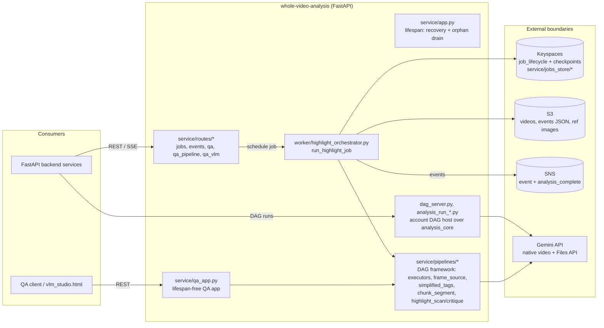

# Vision Engine Architecture

This document describes the `whole-video-analysis` engine. It is the human-readable
companion to the OpenAPI contract in [`contracts/service-openapi.yaml`](../contracts/service-openapi.yaml)
and the checkpoint/lifecycle docs in [`contracts/bjj_backend/`](../contracts/bjj_backend/).
The engine runs Gemini analysis only; the local vision-model workflow (tracking,
upscaling, annotation, human correction) was removed on 2026-11-13.

## System view

## Entry points

- **Production service** — `service/app.py` builds the FastAPI app and wires the full router. Its `lifespan` drains orphan pending jobs and bootstraps recovery so a restart can claim jobs whose owner died mid-run.
- **Account DAG host** — `service/dag_server.py`, `current_account_dag_server.py` and `analysis_run_dispatch.py` host DAG runs defined in `analysis_core` (see [`dag-engine-entrypoint.md`](dag-engine-entrypoint.md)).
- **Standalone QA app** — `service/qa_app.py` mounts the QA routes without the Keyspaces startup requirements.

## Worker orchestration

`service/worker/highlight_orchestrator.py::run_highlight_job` is the only job orchestrator. It ingests a source (S3 object uploaded to the Gemini Files API), runs the `highlight-scan-critique-analyze` DAG per outer chunk, reconciles per-chunk candidates with seam dedup and majority-vote attribution, then publishes axis-only events and `analysis_complete` via SNS. A restart resumes the same `job_id` from the last completed chunk.

## Pipeline DAG framework

`service/pipelines/` implements a declarative DAG framework (`registry.py`, `models.py`, `executors.py`) shared by QA and production. Nodes include `frame_source.py` (frame sampling, with `box_geometry.py`), `simplified_tags.py` (4-axis tagging), `chunk_segment.py` + `time_dedup.py`, `highlight_scan.py` / `highlight_critique.py` / `highlight_axes.py`, and `gemini_retry.py` / `gemini_upload.py`.

## Persistence and events

- **Keyspaces** — `service/jobs_store/` is the durable facade for `job_lifecycle`, checkpoints, latest-job pointers and the recovery index. The engine is the sole durable progress writer; the backend projects these rows through SSE. Rows left by the retired tracking pipeline are read as failed/retired and never resumed.
- **S3** — `service/s3.py` wraps object storage for input videos and result JSON.
- **SNS** — `service/sns.py` + `service/taxonomy_mapper.py` publish axis-only candidates (position, actor, action class, outcome; the specific move in `notes`) and `analysis_complete`.
- **Config** — `service/config.py` is the single env-driven configuration surface.

## Contracts

`contracts/` is the single source of truth for cross-service contracts: `service-openapi.yaml` (REST) and `bjj_backend/` (checkpoint and lifecycle docs).
